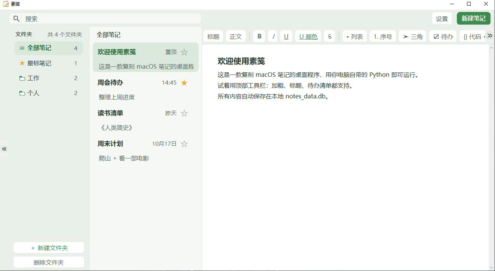

<p align="center">
  
</p>

<h1 align="center">素笺（local-notes）</h1>

<p align="center">
  <em>复刻 macOS 笔记的本地桌面笔记应用 —— Python + Tkinter，零第三方依赖，默认不联网。</em>
</p>

<p align="center">
  
  
  
  
</p>

---

## 简介

**素笺**（仓库名 `local-notes`）是一个致敬 Apple Notes（macOS 笔记）的桌面笔记程序。经典三栏布局——顶部工具栏、左侧文件夹与笔记列表、右侧富文本编辑器，风格简洁克制，专注于「打开就能写」的流畅体验。

与大多数笔记软件不同，素笺**不依赖任何第三方库，也不连接任何云端服务**——只需要电脑上自带的 Python 即可运行。所有文件夹、笔记和设置都保存在本地的 SQLite 数据库中，配合一键导出备份（默认 `.json.gz`，解压后打开也看不到正文、导入自动还原；可留空口令，也可填口令加密），**数据的所有权完全归你自己**。

## 界面预览

<p align="center">
  
</p>
<p align="center"><sub>经典三栏布局：左侧文件夹与笔记列表，右侧富文本编辑器</sub></p>

## 主要功能

**写作与排版**
- 富文本编辑：加粗 / 斜体 / 下划线 / 删除线、两级标题、文字与下划线颜色，样式随笔记保存并精确还原
- 四种列表（项目符号 / 有序 / 三角 / 待办勾选框）、引用块、行内代码、分割线，标记与正文采用同一套缩进标尺
- 列表按钮是**开关**：光标行 / 选区已是同一种列表时再点一次即清除，否则统一转成该类型（多行可批量互转）；有序列表在回车、删除、复制后自动重编号，右键四个列表按钮还能互转 / 重新编号 / 清除
- 第一行恒为标题；`Ctrl+D` / `Ctrl+Y` 整行复制与删除（连同格式与勾选状态）
- **左侧行号**：一格 = 正文当前字号的行高，从上到下等距排开（空行和正文末尾以下的空白也有号）；行号是刻度尺，不跟内容走，插代码块 / 加标题都不会让某一段挤紧。点行号跳到该行；右键行号可隐藏，恢复入口在 `⋯` 菜单
- **`Ctrl+F` 本篇内查找**：浮出查找框，输入即高亮全部命中并显示「第 3 / 12 个」，`Enter` / `Shift+Enter` 上下条、`Esc` 关闭；与左栏的全文搜索互不干扰
- **`Ctrl+H` 查找替换**：同一张浮条展开第二行，可逐处替换或全部替换（`Enter` 替换当前并跳下一条、`Ctrl+Enter` 全部替换）；不区分大小写、保留原有文字样式，一次操作一次 `Ctrl+Z` 撤销，只读与未解锁的加密笔记自动拦截
- **涂鸦标注**：`⋯` 菜单 →「涂鸦标注…」或 `Ctrl+Shift+D`，整个窗口罩上薄雾并锁定界面（顶栏 / 侧栏 / 列表 / 正文一起盖住，不能输入、不能切笔记）；纯图标工具条（**按住可拖到任意位置**）可画自由曲线 / 直线 / 箭头 / 矩形 / 椭圆 / 编号标记，配 4 色与 3 档粗细，支持逐笔撤销与清空；`Esc` 或 ✕ 退出后**所有涂鸦立即消失**，正文、光标、选区、滚动位置原样恢复。笔迹画在独立窗口里，不进笔记内容、不进撤销栈、不进备份
- markdown 快捷输入：段首敲 `# `、`## `、`- `、`1. `、`> `、`-[] `、`-> `、三个反引号或 `---` 即就地成文，结果只留样式

**效率输入**
- **@ 关联笔记**：`@` + 空格浮出候选面板（紧贴文字也认，如「开会@ 」；邮箱里的 `@` 后面不跟空格，不会误触）。面板自带搜索框，弹出即聚焦，输入标题 / 文件夹名实时过滤，空格分词表示「都要命中」；候选**列出全部笔记**，一屏 8 行，滚轮 / 点轨道 / 拖右侧细滚动条都能翻，弹框不会跟着变高；`↑↓` 选择、`Enter` 插入蓝色 `@标题`，单击跳转到目标笔记；存的是 id，改名 / 挪文件夹都不断链
- **超链接**：`[文字](网址)` + 空格直接变蓝，指针悬停浮出小窗可改文字与地址；裸网址同样可点
- **时间函数**：`date()` / `datetime()` + 空格取当前时间
- **公式计算**：`$5+6=` + 空格 → `5+6= 11`，支持括号、`^`、`%`、`sin/cos/tan`，算完即删触发符
- **任务提醒**：正文里插入闹钟图标，到点右下角浮出置顶卡片（日期用日历、时间用时分选择框）

**代码块**
- 内置代码块，顶部语言条随时切换：纯文本 / JSON / XML / HTML / Java / Python / Bash / SQL，等宽字体 + 轻量语法高亮
- 一键复制、一键格式化：JSON / HTML / XML 结构化重排，SQL 按关键词断行（每个字段各占一行），Java / Python / Bash 重排缩进
- 格式化前统一中文标点（仅 JSON / SQL），字符串与注释内部原样保留

**整理与检索**
- 左栏两组：**智能分类**（全部 / 星标 / 加密，按条件筛的视图）+ **文件夹**（可建多级，最多 5 层）；文件夹里第一格是 **系统**，专放内置说明，不可改名 / 删除 / 移动，清空数据后依然在
- 多级文件夹：缩进 + 行首箭头收起 / 展开，父级计数与视图包含整棵子树；支持全部展开 / 全部收起、拖拽移动、右键「移动笔记到…」目标树
- 全文搜索即时过滤（SQLite FTS5，环境不支持时回退 LIKE），命中词在正文里标黄
- 「跳到所属文件夹」：在聚合视图或父视图里右键笔记，一步回到它真正所在的位置
- 列表内**拖拽排序**：上下拖，落点有主题色细线提示；顺序落库，之后改内容不会跳位
- 新建笔记排到列表第一个（置顶笔记之后）：排序优先级是「置顶 → 手动顺序 → 星标 → 最近修改」
- 列表每条笔记左缘一道**辨识色条**（8 色，挑用得最少的分配，颜色随笔记走、不随排序变；超过 8 条必然重复，但相邻两条保证不同色）
- 星标、置顶

**多标签页**
- 点列表里的笔记开成一枚标签，重复点击切回已有的那枚；`Ctrl+Tab` 切换、`Ctrl+W` 关闭、标签上右键可关闭单枚 / 其它 / 所有 / 左侧 / 右侧（只关标签不删笔记），**标签条空白处右键**同样能「关闭所有标签」（外加新建一篇），标签随设置持久化
- 可在「全局设置 → 标签页」里整个关掉（默认开着）：标签条当场消失、标签快捷键一并停用，正文编辑不受影响

**笔记加密**
- 任意笔记可设加密口令：正文在数据库里只留密文，搜索用明文列一并清空
- PBKDF2-HMAC-SHA256（20 万次迭代 + 随机盐）派生密钥，再以 SHA-256 作 PRF 的 CTR 加密 + HMAC 认证，先验签再解密，全部只用标准库
- 切走即重新封上；口令只留在内存、退出即忘，不落盘也无法找回

**数据与备份**
- 本地 SQLite 单文件存储，旧版 JSON 数据首次启动自动迁移
- 单篇导出 `.txt` / `.md` / `.pdf`；整库备份默认导出 `.json.gz`（真 gzip，解压后是**编码容器**、看不到笔记正文，导入自动解码），口令可留空、也可填了做真加密；导入支持覆盖或合并（按正文指纹去重），旧版明文 / 旧版 `.json.gz` 备份照旧能导；内置说明笔记不进备份，导入时按当前版本重建
- 保存失败时另存 `data/pending_*.json` 兜底快照，下次启动提示可恢复
- 单实例运行，避免两个窗口同时改写同一个库

**外观与细节**
- 左栏两列可拖宽（双击分隔条恢复默认）；工具栏可折叠、可自定义显示哪几枚按钮
- 6 套内置主题（云母白 / 石墨灰 / 羊皮纸 / 森林绿 / 午夜蓝 / 晴空蓝），全局设置里是**六枚圆形色卡**：圈内按各主题自己的配色着色、下方写名称，点一下就换，不用下拉框；**首次打开默认森林绿**；两套深色刻意分家：石墨灰＝中性炭灰 + 琥珀金，午夜蓝＝藏蓝 + 靛蓝；晴空蓝＝浅天蓝顶栏与侧栏 + 白稿纸 + 亮蓝强调；**森林绿整窗跟随 WorkBuddy 当前外观**（底色、字色、主题色一起走），其余固定不变。悬停 / 选中 / 浮层的状态色按语义推导，换主题不撞色
- 圆角自绘 UI、长标题悬停跑马灯、顶栏即窗口标题栏
- 高 DPI：声明系统 DPI 感知 + 全局像素缩放，125% / 150% / 200% 下按物理像素渲染；图标按缩放档预渲染，运行时零缩放
- 多显示器：右键菜单 / 悬停气泡 / @ 候选层 / 对话框都按**所在那块屏**的工作区摆位，副屏（坐标为负）上弹出也不会跑到主屏去，贴边时自动内收、不压任务栏
- 手动「检查更新」：读 GitHub Releases 比对版本，后台下载支持断点续传，替换只覆盖程序文件（`data/` 一个字节不动）

## 快速开始

无需安装任何依赖，电脑上有 Python 3 即可运行：

```bash
python scripts/notes_app.py
```

启动后会在项目根目录的 `data/` 下自动创建 `notes_data.db` 数据库文件。

运行测试（`python -m unittest discover -s tests`）与打包 exe（`target/build.bat`）见 [开发与打包](docs/开发与打包.md)。

> 项目图标即仓库中的 [`icon/app_icon.png`](icon/app_icon.png)，同时作为应用窗口 / 任务栏图标（由 `scripts/notes_app.py` 启动时加载）。各尺寸的成品在 [`icon/px/`](icon/px) 下，由 `target/gen_icons.py` 生成 —— 见 [开发与打包](docs/开发与打包.md#图标)。

## 文档

详细用法、数据说明与开发指引都在 [`docs/`](docs/README.md) 下：

| 文档 | 内容 |
| --- | --- |
| [使用指南](docs/使用指南.md) | 界面与操作、文件夹整理、编辑排版、代码块、加密、提醒、搜索 |
| [快捷键](docs/快捷键.md) | 全部快捷键、markdown 快捷输入一览 |
| [数据与备份](docs/数据与备份.md) | 存储位置、导出 / 导入、保存兜底、检查更新与网络访问 |
| [开发与打包](docs/开发与打包.md) | 目录结构、分层依赖、测试、打包 exe、PDF 导出原理 |

## 技术栈

- **语言**：Python 3 ｜ **GUI**：Tkinter ｜ **数据**：SQLite3（FTS5 + trigram，回退 LIKE）——全部标准库
- **分层**：`store`（数据）→ `theme`（配色）/ `dpi`（缩放）→ `widgets`（控件）→ `app_ui` / `app_actions`（界面 / 动作）→ `notes_app`（入口）
- **测试**：标准库 unittest，`python -m unittest discover -s tests`

## 许可证

本项目基于 [Apache License 2.0](LICENSE) 开源。
