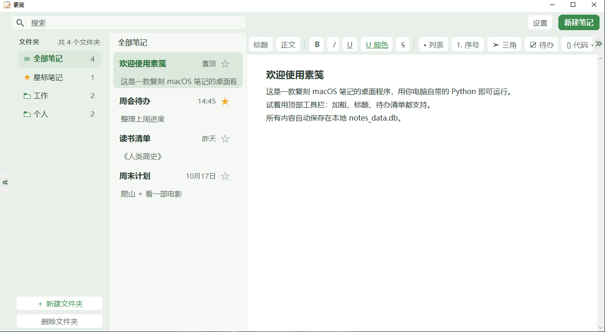

<p align="center">
  
</p>

<h1 align="center">素笺（local-notes）</h1>

<p align="center">
  <em>复刻 macOS 笔记的本地桌面笔记应用 —— Python + Tkinter，零第三方依赖，无需联网。</em>
</p>

<p align="center">
  
  
  
  
</p>

---

## 简介

**素笺**（仓库名 `local-notes`）是一个致敬 Apple Notes（macOS 笔记）的桌面笔记程序。它采用经典的三栏布局——顶部工具栏、左侧文件夹与笔记列表、右侧富文本编辑器，风格简洁克制，专注于「打开就能写」的流畅体验。

与大多数笔记软件不同，素笺**不依赖任何第三方库，也不连接任何云端服务**——只需要电脑上自带的 Python 即可运行。所有文件夹、笔记和设置都保存在本地的 SQLite 数据库中，配合一键 JSON 导出备份，**数据的所有权完全归你自己**。

## 界面预览

<p align="center">
  
</p>
<p align="center"><sub>经典三栏布局：左侧文件夹与笔记列表，右侧富文本编辑器</sub></p>

## 功能特性

**编辑与排版**
- 三栏式布局：工具栏 / 文件夹 + 笔记列表 / 编辑器，还原 macOS 笔记的交互逻辑
- 富文本编辑：标题、正文、**加粗**、*斜体*、下划线、~~删除线~~
- 列表：无序列表（•）、有序列表（1. 2. 3.）、三角形项目符号
- 待办清单（☑ checkbox）：一键勾选，回车自动续写下一项
- 文字颜色与下划线颜色可自选，样式随笔记一起保存、重开精确还原
- 全局正文字号可调，修改后即时全局生效并持久保存

<p align="center">
  
</p>
<p align="center"><sub>顶部工具栏：标题 / 正文、加粗斜体下划线删除线、列表、待办、代码块一键排版</sub></p>

**代码块**
- 内置代码块：顶部语言条可随时切换语言，等宽字体 + 轻量语法高亮
- 支持语言：纯文本、JSON、XML、HTML、Java、Python、Bash、SQL
- 一键**复制**、一键**格式化**（JSON/HTML/XML 结构化重排，其余语言重排缩进）
- 代码块高度自适应，超出后内部滚动，宽度跟随编辑区、窗口缩放不跑版

<p align="center">
  
</p>
<p align="center"><sub>代码块：语法高亮，右上角一键「格式化 / 复制」</sub></p>

**整理与检索**
- 文件夹管理：自定义文件夹，内置「全部笔记」「星标笔记」智能文件夹
- 笔记可在文件夹之间拖拽移动
- 星标、置顶，重要内容置顶显示
- 全文搜索即时过滤，空结果有明确提示

**数据与外观**
- 本地存储：SQLite 单文件数据库，旧版 JSON 数据首次启动自动迁移，不丢历史
- 一键导出备份（JSON），导入支持「覆盖现有数据」或「合并追加」
- 可读取 WorkBuddy 当前皮肤并自动适配配色，也可回退到内置浅灰配色
- 细节打磨：圆角自绘 UI、鼠标滚轮流畅浏览、长标题悬停跑马灯、中文界面优先字体

## 快速开始

无需安装任何依赖，电脑上有 Python 3 即可运行：

```bash
python notes_app.py
```

启动后会在同目录自动创建 `notes_data.db` 数据库文件。

> 项目图标即仓库中的 [`app_icon.png`](app_icon.png)，同时作为应用窗口 / 任务栏图标（由 `notes_app.py` 启动时加载）。

## 数据说明

| 项目 | 说明 |
|---|---|
| 存储方式 | 本地 SQLite（`notes_data.db`），单文件、易备份 |
| 历史迁移 | 首次运行若检测到旧版 `notes_data.json`，自动导入数据库 |
| 导出备份 | 「设置」→「导出备份」→ 生成带时间戳的 JSON 备份文件 |
| 导入数据 | 「设置」→「导入数据」→ 可选覆盖或合并 |
| 网络访问 | 完全不联网，无账号、无同步、无遥测 |

<p align="center">
  
</p>
<p align="center"><sub>「设置」：全局字号调节，以及导出备份 / 导入数据 / 清空</sub></p>

## 目录结构

```
local-notes/
├── notes_app.py     # 全部逻辑：界面、编辑、代码块、数据读写
├── app_icon.png     # 项目 / 应用图标
├── images/          # README 截图
├── notes_data.db    # 本地数据（首次运行自动生成）
├── README.md
└── LICENSE
```

## 技术栈

- **语言**：Python 3
- **GUI**：Tkinter（标准库，零外部依赖）
- **数据**：SQLite3（标准库）
- **单文件实现**：全部逻辑位于 `notes_app.py`，便于阅读与二次开发

## 适用人群

适合想要一个「像系统自带笔记一样简单，但数据完全自主」的轻量笔记工具的用户；也适合作为 Python Tkinter 桌面应用的学习参考项目。

## 许可证

本项目基于 [Apache License 2.0](LICENSE) 开源。
