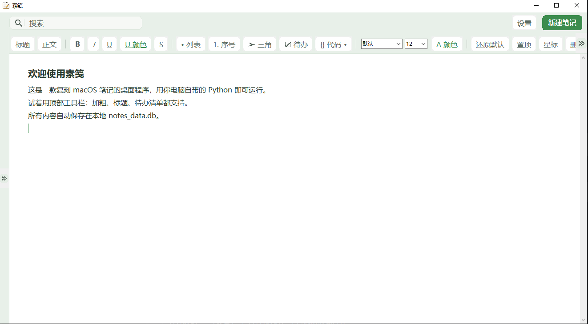
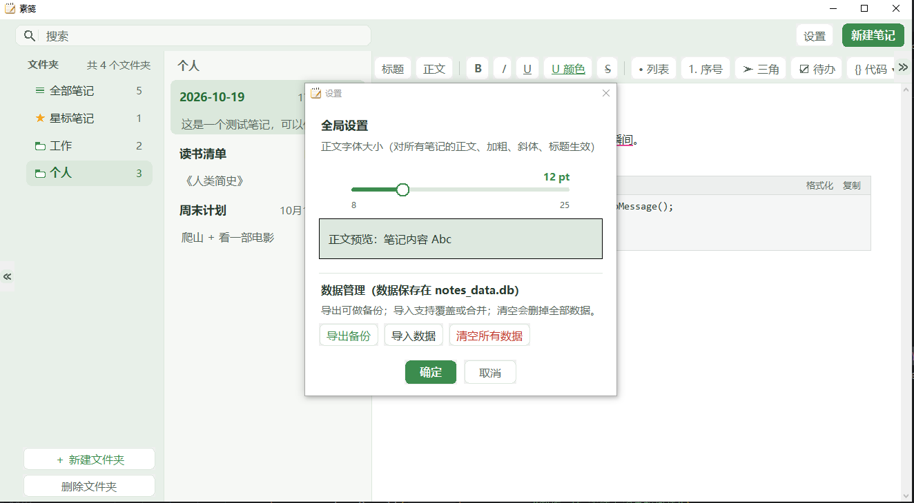
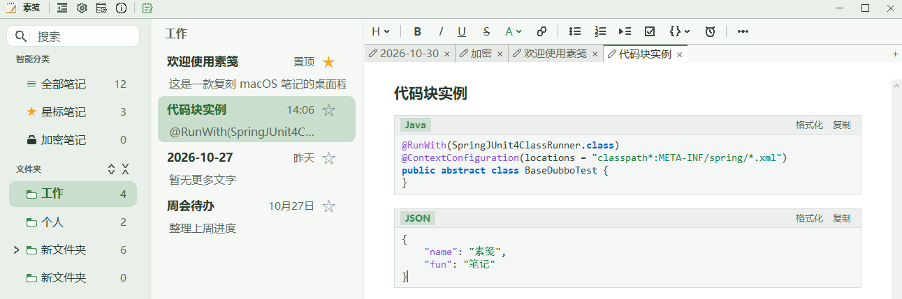
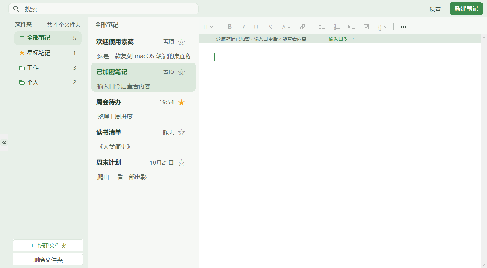

# 使用指南

本文是素笺的完整使用说明：从三栏布局、文件夹整理，到排版细节、代码块、加密与提醒。
快捷键与 markdown 快捷输入单独整理在 [快捷键](快捷键.md)，数据存放与备份见 [数据与备份](数据与备份.md)。

---

## 1. 界面概览

界面是经典的三栏布局：

```
┌──────────────── 顶栏（也是窗口标题栏）────────────────┐
│ 折叠开关 · 齿轮 · 数据库 · 关于 │ 新建笔记 │ 窗口键    │
├───────────┬──────────────┬──────────────────────────┤
│ 搜索框     │  笔记列表     │                          │
│ 智能分类   │  （标题 / 预览 │      富文本编辑器         │
│ 文件夹     │   / 星标 / 日期）│                        │
└───────────┴──────────────┴──────────────────────────┘
```

- **顶栏就是窗口标题栏**：系统那条白色标题栏不再出现，应用把客户区顶到窗口最上沿；阴影、圆角、任务栏按钮、Alt+Tab、贴边缩放仍是系统原生行为。按住顶栏空白处拖动即可移动窗口（双击最大化 / 还原），拖动时窗口内容不重绘、跟着鼠标走。
- 顶栏图标从左到右：折叠开关（原样＝收起、水平镜像＝展开）→ 齿轮（全局设置）→ 数据库（数据管理）→ 圆圈 i（关于）；第二条竖线右侧是记事本（新建笔记，唯一的绿色图标）；最右是窗口键。两条竖线把顶栏断成三段：「我是谁」│「能干什么（看）」│「动手新建」。
- **收起 / 展开左侧两栏只有顶栏一个入口**：就是折叠开关那枚图标，折叠后它依然可见，悬浮提示变成「展开左侧两栏」。左侧两栏收起后不留空白占位，左栏直接贴到窗口左缘，搜索框跟着整列一起收起。
- **全局设置收进齿轮**（也可 `Ctrl + ,`）：正文字体族、正文字号 + 预览。
- **数据管理单独立了一枚图标**：导出备份 / 导入数据 / 清空所有数据，每项都有独立说明。
- **关于单独立了一枚图标**：应用图标与名字、版本号（唯一来源是 `scripts/version.py`）、三行说明、项目地址与问题反馈两条外链，底部是「检查更新」与「关闭」。

<p align="center">
  
</p>
<p align="center"><sub>工具带取侧栏与稿纸之间的浅色，靠底部一条收口线收边；按钮常态隐形、悬停才浮出圆角块，低频项收进 ⋯</sub></p>

### 三栏宽度与工具栏

- **两栏可拖宽**：文件夹栏与笔记列表之间那两条竖线都能按住左右拖，宽度实时跟着走；指针压上去会变成左右箭头、细线染上主题色，**双击恢复默认**（216 / 300）。宽度按像素记进设置，下次启动还在。
- 窗口变窄时会自动夹紧（文件夹最少 150、列表最少 180、正文至少留 320），但**不改写你的设置** —— 窗口再拉宽，列宽原样回来。
- 工具栏可**折叠**（省下 31px 高度），也可**自定义**：在「全局设置 → 工具栏按钮」里勾选要显示哪几枚，右侧「全选 / 全不选」一键清空再挑；⋯ 菜单不可隐藏（导出、折叠工具栏等入口在里面），配置随设置保存。

---

## 2. 文件夹与笔记

### 智能分类与文件夹

左栏分两组：

- **智能分类**：全部笔记 / 星标笔记 / 加密笔记 —— 按条件筛出来的**视图**，不可删除、不可作为笔记的归属。
- **文件夹**：默认「工作」「个人」，以及你自己新建的。真实归属只认这一组。

分组标题把它们隔开。文件夹列表底部不再堆按钮：**空白处右键 →「新建文件夹」**（分组标题、列表下方留白都算空白）；重命名 / 删除 / 移动这些「得先指定某一项」的动作留在文件夹行自己的右键菜单里。

### 多级文件夹

- 右键任意文件夹 →「新建子文件夹」，层级缩进 + 行首箭头收起 / 展开，**最多 5 层**。
- 父文件夹的计数与视图都**包含子文件夹**里的笔记，搜索、移动同理。
- **新建文件夹只插一行**：新行就地落在父支末尾（其它行不重建、不跳）；若在收起的文件夹里建子文件夹，父级会自动展开让新行露出来；新行在视口外时列表做最小幅度的滚动把它带进来。
- 删除文件夹会连同它的子文件夹和里面的笔记一起删，确认框会写明波及范围。

### 收起与展开

某一支有三种走法：点行首箭头、双击文件夹行、右键 →「收起 / 展开子文件夹」。状态随窗口重开记住。

- 点箭头只收放、**不会顺手切换当前文件夹**。
- 列表滚到一半收放时，滚动位置也不回顶 —— 点中的那行原地不动，子行在它下面就地插入（只增删这一支的行，整列不重建）。
- **全部展开 / 全部收起**：「文件夹」分组标题右缘那两枚竖向双箭尖（朝外 = 摊开、朝内 = 收拢），一下把整列收起来或摊开。叶子文件夹不写收起标记（以后在它下面建子文件夹不会凭空不显示）。

### 文件夹图标与箭头

- 展开 = 实心主题色前盖 + 探出的一角稿纸；收起 = 空心描边文件夹；没有子文件夹的叶子始终是空心。
- 行首箭头是线条 chevron（收起 `>`、展开 `v`），占 18×18 的可点区：常态只画箭头，鼠标停上来才浮出圆角层；叶子那一格留空、不画不变手形，名字才对得齐。

### 移动笔记

- 笔记可在文件夹之间**拖拽移动**。
- 右键「移动笔记到…」弹出的是一棵**可收放的目标树**：层级缩进 + 引导线，箭头收放不相关的分支，右边标各自的笔记条数，双击或回车确认。

### 跳到所属文件夹

在全部 / 星标 / 加密视图，或**多级文件夹的父视图**里右键任意笔记，菜单里有「跳到所属文件夹」：直接切到它真正所在的那个文件夹，路径上收着的各级自动展开，这条笔记被选中并滚到眼前。

笔记就摆在当前文件夹时这一项不出现；智能分类里指向已删除文件夹的笔记仍然保留这一行，但置灰。

### 星标与置顶

- 星标：行尾的 ☆ / ★ 按钮，点亮后进入「星标笔记」视图。
- 置顶：重要内容置顶显示。

---

## 3. 编辑与排版

### 标题与段落

- **第一行恒为标题**：笔记的第一行始终是一级标题样式 —— 首行输入的任何内容都自动套用标题，`## `、`> ` 等前缀和 H2 / 引用按钮落到第一行也一律按标题处理；首行回车后，新行恢复正文样式。
- **第一行不能加列表项**：项目符号 / 有序 / 三角 / 待办四个按钮在首行点了会提示，`- `、`1. `、`-> `、`-[] ` 在首行也不转换。
- 两级标题：点工具栏的 `H` 切换，或 `Ctrl+1` / `Ctrl+2` / `Ctrl+0`。

### 字符样式

加粗、斜体、下划线、删除线；文字颜色与下划线颜色可自选，样式随笔记一起保存、重开精确还原。

### 列表与待办

- 列表：无序（●）、有序（1. 2. 3.）、三角形项目符号、待办勾选框；四种都相对正文右移两格（一个汉字宽），缩进是标记的一部分，回车续接、整行删除都不会走样。
- 标记与正文之间一律隔两个空格的位置 —— 按钮插的、markdown 敲的、回车续接出来的，四种列表看起来一般齐。
- **一行太长自动折行时，续行与正文首字对齐**（悬挂缩进），标记留在左边凸出。
- 待办清单：一键勾选，回车自动续写下一项。勾选框是**正文里的一个字符**（⬜ 未勾 / ✅ 已勾），不是浮在文字上的控件 —— 文字再长，框和文字也不会被拆到两行；能选中复制、能撤销、跟着导出一起走；鼠标移到这一行（含文字）变小手，点了就勾。

> 列表的「两格缩进」只对新敲的列表生效 —— 旧笔记里已有的列表行保持原样，只有在你编辑到那一行、回车续接之后才会变成新形态。
> 项目符号的字形是 `●`（U+25CF）；载入老笔记时会把行首的 `•` 换成 `●`（一换一、等长）。
> 老的浮层式勾选框（含 `☐` / `⚪` / `▢` / `☑`）重开时自动转成字符形态，勾选状态与样式原样保留。

### 引用、行内代码、分割线

- **引用**：主题色的淡色纸片 + 上下留白 + 文字缩进两格（与列表同一套标尺），底色铺满整行宽度，连续多行连成一块；**回车续接引用**，把一行引用文字删光即退出引用。
- **行内代码**：等宽字体 + **中性灰**底（不带主题色）—— 与有色的引用、深色的选中块区分开。
- **分割线**：一条跟随编辑区宽度的横线。

### 超链接

- 段中敲 `[显示文字](网址)` 再打一个空格，括号和网址当场收起来、只剩显示文字，文字变蓝 + 蓝色下划线。
- **指针在链接上停一下就浮出小窗**，里面是「显示文字」和「链接地址」两栏，都能直接改（清空地址后回车即取消链接，显示文字留空表示不改）。
- 裸网址打完空格同样自动变蓝，悬停它也能改显示文字（一改就升级成「文字与地址分开存」的富链接）。
- 单击链接用系统浏览器打开；链接文字和普通文字一样能选中、能改、能删，不是隐藏起来的语法。

### @ 关联笔记

- 正文里敲 `@` + 空格，光标下方浮出候选面板（最近修改优先，带所属文件夹），继续打字即过滤，↑↓ 选择、Enter 插入、Esc 取消，也能鼠标点击。
- 选中后插入蓝色的 `@标题`，**单击它直接跳到那篇笔记**（在别的文件夹就一并切过去）。
- 链接存的是笔记 id 而不是标题：目标改名、挪文件夹都不会断链；目标被删了，点击会提示而不是静默失败。候选里不列当前笔记和还没解锁的加密笔记。

### 时间函数与公式

- `date()` + 空格 → `2026-10-23`；`datetime()` + 空格 → `2026-10-23 19:13:05`。只在行尾敲完空格 / 回车那一刻展开一次，写进正文后就不会自己变。
- **公式**：`$` 起头的算式，敲完 `=` 再敲空格就补上结果 —— `$5+6=` ␣ → `5+6= 11`。
  - `$` 只是「我要算」的触发键，**算完即删掉**，留在正文里的只有算式和结果；删掉后这行也不再是公式，再敲空格不会二次求值。
  - 支持 `+ - * /`、括号、`^` 幂、`%` 取模、`sin/cos/tan`（参数按**度**，可写 `tan30` 或 `tan(30)`），全角 `＋ × ÷ （）` 也认；结果最多两位小数（四舍五入）。
  - **必须是 `$` 起头**才计算；`$` 后跟汉字或字母（`$合计=`、`$x^2=`）一律当普通文字，给 markdown 的 `$…$` 写法留了后路；算不出来（除零、`tan90`、语法不通）就静默不补值、`$` 原样留着。
  - 结果是纯文本，不挂隐藏标记；删 `$` 与补结果是同一个撤销单元，一次 `Ctrl+Z` 全部退回。

### markdown 快捷输入

段首敲 `# ` / `## ` / `- ` / `1. ` / `> ` / `-[] ` / `-> ` / 三个反引号，再敲一个空格，就地变成对应格式；三个反引号后带语言名（如 ` ```python `）敲回车同样直接生成代码块；`---` 敲完回车变分割线。结果只留样式，正文里不会残留 markdown 符号，一次 `Ctrl+Z` 就能整段撤回。

完整对照表见 [快捷键 · markdown 快捷输入](快捷键.md#markdown-快捷输入)。

### 整行操作

- `Ctrl+D`：复制光标所在行（连同加粗 / 标题 / 引用 / 待办勾选状态一并复制），插到下面。
- `Ctrl+Y`：删掉光标所在行；拖选了几行就对这几行生效。

### 字号与字体

- **字号只在设置里改**：滑杆调的是正文大小，H1 / H2 按比例（1.35 / 1.15）跟着缩放 —— 正文 12 号时是 16 / 14 号，正文 20 号时是 27 / 23 号，层级不会因为放大正文而塌掉。
- 正文字体可换（默认 / 雅黑 / 黑体 / 宋体 / 楷体 / Consolas），即时全局生效并持久保存。

<p align="center">
  
</p>
<p align="center"><sub>「全局设置」（顶栏齿轮 / Ctrl + ,）：正文字体 / 正文大小，预览里能直接看出层级</sub></p>

### 底部状态条

指针挪到编辑区**底部**那一带才浮出「创建时间 · 最后修改时间 · 字数」，移开即收起。它贴在正文下边缘、正好占住正文的下留白，不遮挡任何一行；加密未解锁时这里显示「已加密 · 未解锁」。

### 内置示例笔记

内置的「欢迎使用素笺」是**只读**的：不能编辑、不能删除，正文里列着全部快捷键。打开它时编辑区上方会出现一条提示条，工具栏整体置灰；文字仍可选中复制。

---

## 4. 代码块

- 内置代码块：顶部语言条可随时切换语言，等宽字体 + 轻量语法高亮；高度自适应，超出后内部滚动，宽度跟随编辑区、窗口缩放不跑版。
- 支持语言：纯文本、JSON、XML、HTML、Java、Python、Bash、SQL。
- 一键**复制**、一键**格式化**：
  - JSON / HTML / XML —— 结构化重排，按括号与标签层级缩进。
  - **SQL —— 按关键词断行**：`SELECT` 之后另起一行，**每个字段各占一行**并退四格，`FROM` 自己占一行，`WHERE` / `AND` / `OR` / `GROUP BY` / `ORDER BY` / `JOIN` / `UNION` … 之前断开，一行里挤三个 AND 的长句会被摊成一行一个条件；括号内（子查询、`IN (…)`、函数参数、`GROUP BY` 的字段串）不动，字符串里的 `AND` 也不动。除下面那条中文标点归一化外，只重排空白（大小写原样）。
  - Java / Bash / Python —— 重排行首缩进。
- 格式化前先**统一中文标点**（仅 JSON / SQL）：中文输入法下敲出来的全角逗号 `，` 与中文引号 `“”` / `‘’` 会先换成英文的 `,` / `"` / `'`，**JSON 另含中文冒号 `：` → `:`**，再走结构化重排 —— 从聊天、日志里抄来的 `IN (81862，82929)`、`{“name”：“张三”}` 按一次「格式化」就能直接解析。只换这几枚符号，全角分号 / 括号不动（SQL 的冒号也不动：`:` 是命名参数与 `:=` 的语法字符）；**字符串与注释内部原样保留**。

<p align="center">
  
</p>
<p align="center"><sub>代码块：语法高亮，右上角一键「格式化 / 复制」</sub></p>

---

## 5. 多标签页

- 点列表里的笔记就开成一枚标签，已经开着的那篇会**切回去**而不是再开一份。
- 标签带 ×（中键单击也能关），右键可「关闭其它」/「关闭左侧」/「关闭右侧」；`Ctrl+W` 关当前，`Ctrl+Tab` / `Ctrl+Shift+Tab` 来回切换（`Ctrl+PageDown` / `Ctrl+PageUp` 同）。
- 编辑器始终只有一份正文，切标签 = 存住这篇、装下一篇，所以**撤销栈不跨标签保留**。
- 开着的标签随设置持久化，重启后还在；标签多了横向滚动（两端浮出箭头），最右边的 `+` 直接新建笔记。

---

## 6. 笔记加密

- 任意笔记右键 →「设置加密口令…」。设好之后，这篇笔记的正文在数据库里**只留密文**：`content` 和 `plain`（搜索用的明文列）都写成空，翻数据库、搜关键词都看不到内容。
- 切换笔记 = 立刻重新封上（内存里不留明文），切回来要口令；重开程序同样要口令。
- **只有一种情况不用重新输入**：在加密笔记之间切换，且下一篇的口令与**当前这篇**相同 —— 直接打开，不再询问。除此之外都要输入口令：从明文笔记切过来、重开程序、以及两篇口令不同（每篇 salt 不同，程序只能拿当前口令去解一次才知道是不是同一个）。
- 口令只留在内存、退出即忘，不会写进数据库或任何文件。
- 没解锁时：列表标题只露标题首字 + 一个星号（如「周\*」，互相能区分，泄漏量一个字符，这个字存在密文块里随密文走）；正文区显示「文字已加密」，工具栏置灰，编辑区上方一条提示条，点右侧「输入口令 →」即可解锁。
  - 升级前就加密的老笔记没有存这个首字，第一次解锁后会补上。
- 加密方式：PBKDF2-HMAC-SHA256（20 万次迭代，随机盐）派生密钥，再用 SHA-256 作伪随机函数的 CTR 模式加密 + HMAC 认证 —— **先验签再解密**，密文改一个字节就打不开，全部只用标准库。
- 口令本身不落盘，也没有「找回」：**忘记口令等于内容永久丢失**，这是设计取舍，不是缺陷。

<p align="center">
  
</p>
<p align="center"><sub>没解锁时的样子：列表标题是「周\*」这种遮蔽形态，正文写着「文字已加密」，点提示条右侧「输入口令 →」打开</sub></p>

---

## 7. 任务提醒

- 工具栏那枚小闹钟，点开填「提醒什么 + 什么时候」，正文里就多一枚 16px 的闹钟图（图来自 `icon/notice.png`）。
- 鼠标停上去显示时间与内容，响过之后显示「已提醒」；右键可编辑或删除，**删掉图标就等于取消这条提醒**。到点时右下角浮出一张置顶小卡片。
- 时间用**时 / 分选择框**（上下箭头或直接键入，范围锁死 0-23 / 0-59，旁边有「现在」）；日期用**日历**（点格子选日，`‹ ›` 翻月，右上角「今天」一键跳回，今天那格用强调色标出）。不勾「到点提醒」就只是正文里一个标记，永远不响（此时日历和时分一起变灰）。
- ⚠️ 两种「不响」是设计好的：**程序关着的时候不会提醒**；关着的这段时间里错过的，超过 10 分钟就不再补弹（只在下次悬停时显示已提醒），免得开机一次弹一串窗口。

---

## 8. 搜索

- 全文搜索即时过滤，走 SQLite FTS5 索引（环境不支持时自动回退 LIKE；搜索词里的 `%` `_` 按字面匹配），空结果有明确提示。
- **搜索框住在文件夹列表顶部**：白底描边样式，宽度始终等于所在列宽减去左右留白；收起左侧两栏时它跟着整列一起收起，展开后回到原位置。
- **命中词在正文里标黄**：搜索时当前打开的这篇里，每个命中的关键词都会铺一层琥珀色底；改动关键词就跟着重标，把关键词删空，高亮立刻消失。黄底只存在于屏幕上，不会写进笔记。

---

## 9. 外观

- 可读取 WorkBuddy 当前皮肤并自动适配配色，也可回退到内置浅灰配色。
- **状态色按语义推导，不直接吃皮肤给的值**：悬停＝所在底色暗一档（只动明度、保住色相），选中＝所在底色 + 主题色，浮层＝稿纸 + 一层主题色再压到与稿纸反差达标。换主题、换深浅都自动成立，也不会再出现「悬停和选中同色」这类撞色。
- 工具条底色取侧栏与稿纸之间的浅色，形成「侧栏 → 工具带 → 白稿纸」的渐次提亮，靠底部收口线收边；按钮常态与底同色（无框无底），悬停 / 按下只压明度不改色相。
- 细节打磨：圆角自绘 UI、鼠标滚轮流畅浏览、长标题悬停跑马灯、中文界面优先字体。

---

## 10. 导出单篇笔记

工具栏「⋯」菜单可选纯文本 `.txt` / Markdown `.md` / PDF `.pdf`，文件名默认取笔记标题，只读的示例笔记也能导。

PDF 是 A4 排版、用系统字体现画的，**没有文字层**（不可选中、不可检索），换来的是零依赖、字形与界面一致。原理与代价见 [开发与打包 · 关于 PDF 导出](开发与打包.md#关于-pdf-导出)。
