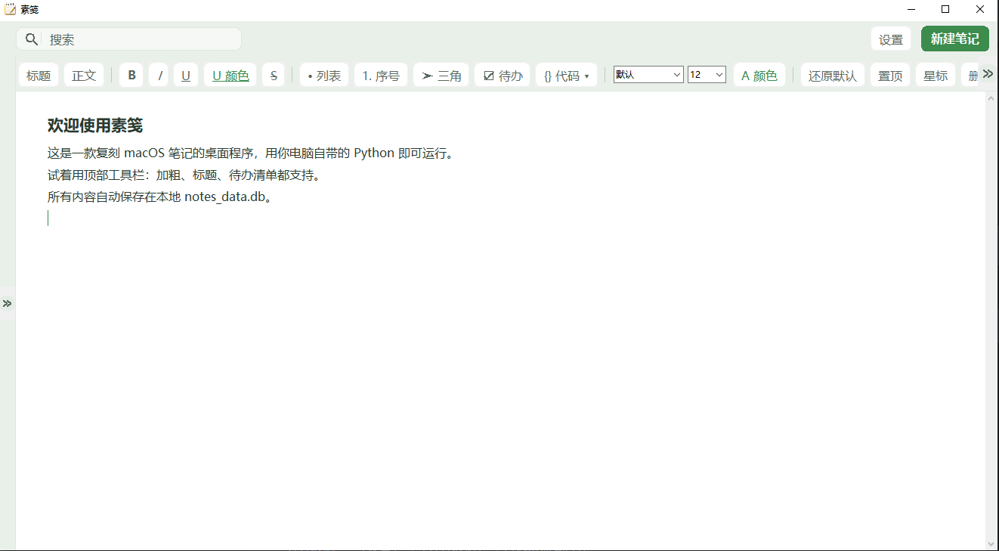
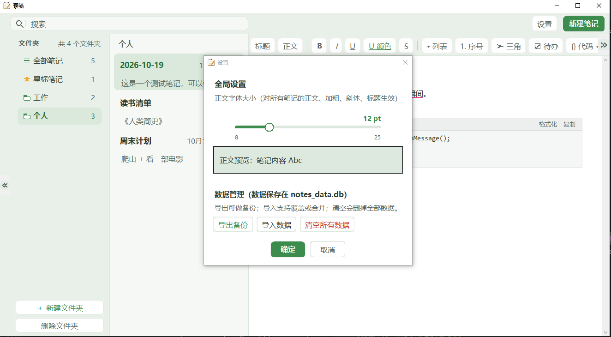
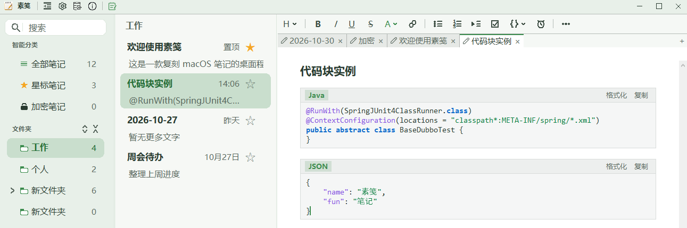
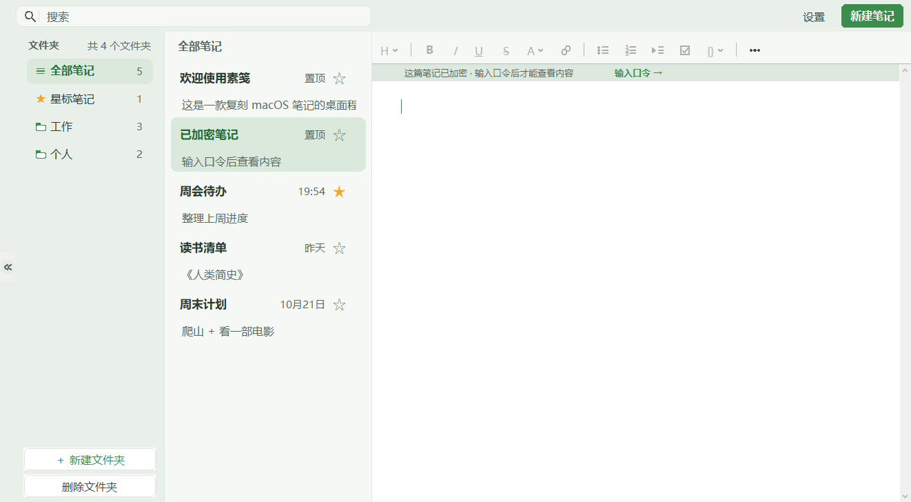

# 使用指南

本文是素笺的完整使用说明：从三栏布局、文件夹整理，到排版细节、代码块、加密与提醒。
快捷键与 markdown 快捷输入单独整理在 [快捷键](快捷键.md)，数据存放与备份见 [数据与备份](数据与备份.md)。

---

## 1. 界面概览

界面是经典的三栏布局：

```
┌──────────────── 顶栏（也是窗口标题栏）────────────────┐
│ 折叠开关 · 齿轮 · 数据库 · 关于 │ 新建笔记 │ 窗口键    │
├───────────┬──────────────┬──────────────────────────┤
│ 搜索框     │  笔记列表     │                          │
│ 智能分类   │  （标题 / 预览 │      富文本编辑器         │
│ 文件夹     │   / 星标 / 日期）│                        │
└───────────┴──────────────┴──────────────────────────┘
```

- **顶栏就是窗口标题栏**：系统那条白色标题栏不再出现，应用把客户区顶到窗口最上沿；阴影、圆角、任务栏按钮、Alt+Tab、贴边缩放仍是系统原生行为。按住顶栏空白处拖动即可移动窗口（双击最大化 / 还原），拖动时窗口内容不重绘、跟着鼠标走。
- 顶栏图标从左到右：折叠开关（原样＝收起、水平镜像＝展开）→ 齿轮（全局设置）→ 数据库（数据管理）→ 圆圈 i（关于）；第二条竖线右侧是记事本（新建笔记，唯一的绿色图标）；最右是窗口键。两条竖线把顶栏断成三段：「我是谁」│「能干什么（看）」│「动手新建」。
- **收起 / 展开左侧两栏只有顶栏一个入口**：就是折叠开关那枚图标，折叠后它依然可见，悬浮提示变成「展开左侧两栏」。左侧两栏收起后不留空白占位，左栏直接贴到窗口左缘，搜索框跟着整列一起收起。
- **全局设置收进齿轮**（也可 `Ctrl + ,`）：四节平级 —— 字体设置（正文字体族 / 字号 + 预览）、外观主题、工具栏按钮定制、标签页，各带一枚主题色小图标。外观主题是六枚圆形色卡、点一下即换，完整说明见第 9 节「外观」。
- **数据管理单独立了一枚图标**：导出备份 / 导入数据 / 清空所有数据，每项都有独立说明。
- **关于单独立了一枚图标**：应用图标与名字、版本号（唯一来源是 `scripts/version.py`）、三行说明、项目地址与问题反馈两条外链，底部是「检查更新」与「关闭」。

<p align="center">
  
</p>
<p align="center"><sub>工具带取侧栏与稿纸之间的浅色，靠底部一条收口线收边；按钮常态隐形、悬停才浮出圆角块，低频项收进 ⋯</sub></p>

### 三栏宽度与工具栏

- **两栏可拖宽**：文件夹栏与笔记列表之间那两条竖线都能按住左右拖，宽度实时跟着走；指针压上去会变成左右箭头、细线染上主题色，**双击恢复默认**（216 / 300）。宽度按像素记进设置，下次启动还在。
- 窗口变窄时会自动夹紧（文件夹最少 150、列表最少 180、正文至少留 320），但**不改写你的设置** —— 窗口再拉宽，列宽原样回来。
- 工具栏可**折叠**（省下 31px 高度），也可**自定义**：在「全局设置 → 工具栏按钮定制」里勾选要显示哪几枚（两个列表项按正式叫法写作「无序列表 / 有序列表」），右侧「全选 / 全不选」一键清空再挑；⋯ 菜单不可隐藏（导出、折叠工具栏等入口在里面），配置随设置保存。共 15 枚，`⋯` 左边那枚是「自动换行」开关（见第 3 节）；窗口较窄时右端会出现滑动箭头，点一下能滚到靠右的按钮。
- 标签条也能**整个关掉**：「全局设置 → 标签页 → 启用多标签页」默认勾着；取消勾选后标签条当场消失、`Ctrl + Tab` / `Ctrl + W` 一并停用（正文照旧编辑，关掉不影响任何内容），重新勾上就把上次开着的那几枚标签恢复回来。

---

## 2. 文件夹与笔记

### 智能分类与文件夹

左栏分两组：

- **智能分类**：全部笔记 / 星标笔记 / 加密笔记 / 任务提醒 —— 前三格按条件筛出来的**视图**，「任务提醒」是一张自动汇总表（见 §7）。四格都不可改名、不可删除、不可移动，也不可作为笔记的归属。
- **文件夹**：默认「工作」「个人」，以及你自己新建的。真实归属只认这一组。
- **系统**：文件夹里的第一格（在「工作」上面），只装内置的「欢迎使用素笺」。不可改名、不可删除、不可移动，笔记也拖不进去；清空数据后它照样在。`Ctrl+N` 时如果正停在它上面，新笔记落到「工作」。

分组标题把它们隔开。文件夹列表底部不再堆按钮：**空白处右键 →「新建文件夹」**（分组标题、列表下方留白都算空白）；重命名 / 删除 / 移动这些「得先指定某一项」的动作留在文件夹行自己的右键菜单里。

### 多级文件夹

- 右键任意文件夹 →「新建子文件夹」，层级缩进 + 行首箭头收起 / 展开，**最多 5 层**。
- 父文件夹的计数与视图都**包含子文件夹**里的笔记，搜索、移动同理。
- **新建文件夹只插一行**：新行就地落在父支末尾（其它行不重建、不跳）；若在收起的文件夹里建子文件夹，父级会自动展开让新行露出来；新行在视口外时列表做最小幅度的滚动把它带进来。
- 删除文件夹会连同它的子文件夹和里面的笔记一起删，确认框会写明波及范围。

### 收起与展开

某一支有三种走法：点行首箭头、双击文件夹行、右键 →「收起 / 展开子文件夹」。状态随窗口重开记住。

- 点箭头只收放、**不会顺手切换当前文件夹**。
- 列表滚到一半收放时，滚动位置也不回顶 —— 点中的那行原地不动，子行在它下面就地插入（只增删这一支的行，整列不重建）。
- **全部展开 / 全部收起**：「文件夹」分组标题右缘那两枚竖向双箭尖（朝外 = 摊开、朝内 = 收拢），一下把整列收起来或摊开。叶子文件夹不写收起标记（以后在它下面建子文件夹不会凭空不显示）。

### 文件夹图标与箭头

- 展开 = 实心主题色前盖 + 探出的一角稿纸；收起 = 空心描边文件夹；没有子文件夹的叶子始终是空心。
- 行首箭头是线条 chevron（收起 `>`、展开 `v`），占 18×18 的可点区：常态只画箭头，鼠标停上来才浮出圆角层；叶子那一格留空、不画不变手形，名字才对得齐。

### 移动笔记

- 笔记可在文件夹之间**拖拽移动**。
- 右键「移动笔记到…」弹出的是一棵**可收放的目标树**：层级缩进 + 引导线，箭头收放不相关的分支，右边标各自的笔记条数，双击或回车确认。

### 笔记左边的色条

- 每条笔记左缘有一道 4px 宽的圆头色条，8 种颜色轮着用，扫一眼就能把相邻的几条分开（是「区分」，不是「报警」，红的也不代表什么）。
- 颜色在**新建那一刻**定下来，之后拖动排序、改标题、切文件夹、重开程序都不变；新笔记一律挑当前用得最少的那个颜色，所以用久了也不会出现一片同色。
- 笔记超过 8 条时颜色必然有重复（调色板只有 8 个），但**相邻的两条一定不同色**：挨在一起时会自动给下面那条换一个颜色，并且记进库里。换色只会发生在真的撞上时，平时不会有笔记者无缘无故变色。
- 颜色存在本地库里，跟着笔记走：导出备份会带上它，换台机器导入回来还是那条色条。

### 拖动排序

- 在中间列表里按住一条笔记上下拖，行与行之间会出现一条主题色细线标出落点（拖动时鼠标旁还有一张浮起的小标题，提示「拎着的是哪一条」），松手即就位。
- 只在**同一分组**内重排：置顶的排在置顶区、星标的排在星标区。把普通笔记往置顶区拖不会生效 —— 松手后排序规则也会把它弹回原处，不如干脆不接。
- 拖过之后列表就按你排的顺序走，写正文、改标题都不会让这条笔记突然跳到顶部；新建笔记、加星标、置顶、换文件夹仍然各自进分组的**最上面**。
- 拖到左侧文件夹行上仍然是「移动文件夹」—— 同一个手势，按落点分流：落在列表里 = 排序，落在文件夹上 = 换文件夹。
- 搜索结果里不接排序（那套顺序是临时的，记下来没有意义）。顺序存放在本地库的笔记表里，随数据一起走。

### 跳到所属文件夹

在全部 / 星标 / 加密视图，或**多级文件夹的父视图**里右键任意笔记，菜单里有「跳到所属文件夹」：直接切到它真正所在的那个文件夹，路径上收着的各级自动展开，这条笔记被选中并滚到眼前。

笔记就摆在当前文件夹时这一项不出现；智能分类里指向已删除文件夹的笔记仍然保留这一行，但置灰。

### 星标与置顶

- 星标：行尾的 ☆ / ★ 按钮，点亮后进入「星标笔记」视图。
- 置顶：重要内容置顶显示，永远排在列表最上面。
- **新建的笔记排在哪**：置顶笔记之后、其余所有笔记之前。新建那一刻它拿到一个最小的顺序值，所以立刻出现在列表上方；置顶是用户亲手钉上去的，不被新建动作顶掉。
- 排序的完整优先级是「置顶 → 手动顺序（拖过 / 新建的）→ 星标 → 最近修改」。星标排在手动顺序之后：星标是自动分组，手动顺序是明确的摆放意图，后者优先。

---

## 3. 编辑与排版

### 标题与段落

- **第一行恒为标题**：笔记的第一行始终是一级标题样式 —— 首行输入的任何内容都自动套用标题，`## `、`> ` 等前缀和 H2 / 引用按钮落到第一行也一律按标题处理；首行回车后，新行恢复正文样式。
- **第一行不能加列表项**：项目符号 / 有序 / 三角 / 待办四个按钮在首行点了会提示，`- `、`1. `、`-> `、`-[] ` 在首行也不转换。
- 两级标题：点工具栏的 `H` 切换，或 `Ctrl+1` / `Ctrl+2` / `Ctrl+0`。

### 字符样式

加粗、斜体、下划线、删除线；文字颜色与下划线颜色可自选，样式随笔记一起保存、重开精确还原。

### 列表与待办

- 列表：无序（●）、有序（1. 2. 3.）、三角形项目符号、待办勾选框；四种都相对正文右移两格（一个汉字宽），缩进是标记的一部分，回车续接、整行删除都不会走样。
- 标记与正文之间一律隔两个空格的位置 —— 按钮插的、markdown 敲的、回车续接出来的，四种列表看起来一般齐。
- **一行太长自动折行时，续行与正文首字对齐**（悬挂缩进），标记留在左边凸出。
- 待办清单：一键勾选，回车自动续写下一项。勾选框是**正文里的一个字符**（⬜ 未勾 / ✅ 已勾），不是浮在文字上的控件 —— 文字再长，框和文字也不会被拆到两行；能选中复制、能撤销、跟着导出一起走；鼠标移到这一行（含文字）变小手，点了就勾。
- 复制（Ctrl+C / Ctrl+D）粘贴出来的待办照样能勾：剪贴板里只有文字、带不走样式，所以粘完会自动把方框的样式和点击补上，一次粘十行也不会有哪一行点不动。

> 列表的「两格缩进」只对新敲的列表生效 —— 旧笔记里已有的列表行保持原样，只有在你编辑到那一行、回车续接之后才会变成新形态。
> 项目符号的字形是 `●`（U+25CF）；载入老笔记时会把行首的 `•` 换成 `●`（一换一、等长）。
> 老的浮层式勾选框（含 `☐` / `⚪` / `▢` / `☑`）重开时自动转成字符形态，勾选状态与样式原样保留。

### 引用、行内代码、分割线

- **引用**：主题色的淡色纸片 + 上下留白 + 文字缩进两格（与列表同一套标尺），底色铺满整行宽度，连续多行连成一块；**回车续接引用**，把一行引用文字删光即退出引用。
- **行内代码**：等宽字体 + **中性灰**底（不带主题色）—— 与有色的引用、深色的选中块区分开。
- **分割线**：一条跟随编辑区宽度的横线。

### 超链接

- 段中敲 `[显示文字](网址)` 再打一个空格，括号和网址当场收起来、只剩显示文字，文字变蓝 + 蓝色下划线。
- **指针在链接上停一下就浮出小窗**，里面是「显示文字」和「链接地址」两栏，都能直接改（清空地址后回车即取消链接，显示文字留空表示不改）。
- 裸网址打完空格同样自动变蓝，悬停它也能改显示文字（一改就升级成「文字与地址分开存」的富链接）。
- 单击链接用系统浏览器打开；链接文字和普通文字一样能选中、能改、能删，不是隐藏起来的语法。

### @ 关联笔记

- 正文里敲 `@` + 空格，光标下方浮出候选面板。**前面有没有文字都行**（`今天开会@ ` 同样能弹），邮箱 `zhang@163.com` 这类 `@` 后面不跟空格，不会误触。
- 面板顶部是**搜索框**，弹出时焦点就在里面：直接输入标题或所在文件夹名即实时过滤，空格分词表示「几个词都要命中」；右侧 `✕` 一键清空。`↑↓` 选择、`Enter` / `Tab` 插入、`Esc` 取消，也能鼠标点击。焦点若没落在搜索框（或你点回正文），继续在正文里打字同样会同步成查询词，两条路互不打架。
- 候选**列出全部笔记**，不是只给前 8 条：一屏固定 8 行，右侧有一条细滚动条，鼠标滚轮、点轨道翻页、拖拇指都能翻到任意一篇；弹框尺寸不随笔记数变高。键盘一路按 `↓` 越过一屏时，列表会自动跟过去。
- 默认按最近修改排序（带所属文件夹），选中后插入蓝色的 `@标题`，**单击它直接跳到那篇笔记**（在别的文件夹就一并切过去）。
- 链接存的是笔记 id 而不是标题：目标改名、挪文件夹都不会断链；目标被删了，点击会提示而不是静默失败。候选里不列当前笔记和还没解锁的加密笔记。

### 时间函数与公式

- `date()` + 空格 → `2026-10-23`；`datetime()` + 空格 → `2026-10-23 19:13:05`。只在行尾敲完空格 / 回车那一刻展开一次，写进正文后就不会自己变。
- **公式**：`$` 起头的算式，敲完 `=` 再敲空格就补上结果 —— `$5+6=` ␣ → `5+6= 11`。
  - `$` 只是「我要算」的触发键，**算完即删掉**，留在正文里的只有算式和结果；删掉后这行也不再是公式，再敲空格不会二次求值。
  - 支持 `+ - * /`、括号、`^` 幂、`%` 取模、`sin/cos/tan`（参数按**度**，可写 `tan30` 或 `tan(30)`），全角 `＋ × ÷ （）` 也认；结果最多两位小数（四舍五入）。
  - **必须是 `$` 起头**才计算；`$` 后跟汉字或字母（`$合计=`、`$x^2=`）一律当普通文字，给 markdown 的 `$…$` 写法留了后路；算不出来（除零、`tan90`、语法不通）就静默不补值、`$` 原样留着。
  - 结果是纯文本，不挂隐藏标记；删 `$` 与补结果是同一个撤销单元，一次 `Ctrl+Z` 全部退回。

### markdown 快捷输入

段首敲 `# ` / `## ` / `- ` / `1. ` / `> ` / `-[] ` / `-> ` / 三个反引号，再敲一个空格，就地变成对应格式；三个反引号后带语言名（如 ` ```python `）敲回车同样直接生成代码块；`---` 敲完回车变分割线。结果只留样式，正文里不会残留 markdown 符号，一次 `Ctrl+Z` 就能整段撤回。

完整对照表见 [快捷键 · markdown 快捷输入](快捷键.md#markdown-快捷输入)。

### 整行操作

- `Ctrl+D`：复制光标所在行（连同加粗 / 标题 / 引用 / 待办勾选状态一并复制），插到下面。
- `Ctrl+Y`：删掉光标所在行；拖选了几行就对这几行生效。

### 字号与字体

- **字号只在设置里改**：滑杆调的是正文大小，H1 / H2 按比例（1.35 / 1.15）跟着缩放 —— 正文 12 号时是 16 / 14 号，正文 20 号时是 27 / 23 号，层级不会因为放大正文而塌掉。
- 正文字体可换（默认 / 雅黑 / 黑体 / 宋体 / 楷体 / Consolas），即时全局生效并持久保存。

<p align="center">
  
</p>
<p align="center"><sub>「全局设置」（顶栏齿轮 / Ctrl + ,）：字体设置里换字体与字号，预览能直接看出层级；外观主题是六枚圆形色卡，圈内按各主题配色着色、点一下即换；下面还有工具栏按钮定制 / 标签页</sub></p>

### 行号

- 编辑区左侧有一列行号，**一格的高度就是正文当前字号的行高**，从上到下等距排开：空行也有号，正文写完之后往下照样接着数到画面底部。
- 行号是「刻度尺」，不跟内容走：插代码块、加标题、改字号都不会让某一段突然挤紧或拉开；一行被折成三行也只占一格。
- 行号列的**宽度是固定的**（按当前字号预留 4 位数）：写到第 100 行、第 1000 行，这一列都不会突然变宽把正文推一下。
- 点行号就把光标移到那一行行首；滚轮停在行号上照样滚正文。
- **右键行号 →「隐藏行号」**。关掉之后恢复入口在工具栏最右边的 `⋯` 菜单里：**「显示行号」**，点一下回来（开着的时候这一项右侧有一枚对勾）。开关跟着设置保存，重启保持。

### 自动换行

- 工具栏 `⋯` 左边那枚 **↵** 就是自动换行开关，**默认关闭**：一行写到窗口右边界也不折，一直往右延伸；真有超宽长行时，正文底沿会浮出一条细横向滚动条，也可以按住 `Shift` 滚鼠标滚轮左右看。按钮亮着（一层淡强调底）表示已开启。
- 点一下切到**软换行**：一行占满后**按字符**折到下一行，一定排到右边界才折；同一段文字复制两遍、段间只有空格时，第二遍也接着上一行往下排，不会退回空格处从行首重新起排、在上一行留一截空白。**窗口拉宽、字号放大、换字体时折行位置由编辑区自己实时重算**，不用手动补换行，也绝不会往笔记里插换行符 —— 内容、导出、备份里始终是原来那一整行。再点一下回到不换行。
- 这是**全局视图开关**，不是每篇笔记的属性：切笔记、切标签都不变；状态记进设置，重启沿用上次选择（首次打开是关闭）。只读的示例笔记、未解锁的加密笔记里也照常可切。
- 「全局设置 → 工具栏按钮定制」里可以把它隐藏；隐藏后仍可用设置里的勾选恢复。

### 查找（Ctrl + F）

- 按 `Ctrl + F`，正文右上角浮出查找框，边输入边高亮**当前这篇**里的所有命中；右上角显示「第 3 / 12 个」。
- `Enter` / `↓` 下一个，`Shift + Enter` / `↑` 上一个，到头会绕回第一个；`Esc` 或 `✕` 关掉并清除高亮。
- 有选中文字时按 `Ctrl + F`，会把它填进输入框直接搜。
- 这里搜的是**当前正文**，不动左栏列表；要跨全部笔记搜，用左栏顶部的搜索框（两者高亮互不干扰）。关闭查找框不会把搜索框的标黄一起抹掉。

### 涂鸦标注（Ctrl + Shift + D）

- 入口在工具栏最右边的 `⋯` 菜单 →**「涂鸦标注…」**，或直接按 `Ctrl + Shift + D`；再按一次、点工具条最右的 `✕`、或按 `Esc` 都能退出。
- 进入后**整个窗口罩上一层薄雾**（顶栏 / 侧栏 / 笔记列表 / 正文 / 状态条一块盖住），内容看得见但完全不能操作：不能打字、粘贴、滚轮翻页，也点不动工具栏、文件夹和标签条。内置说明笔记这类只读笔记同样可以标注。
- 底部是一排纯图标工具条，从左到右：**画笔 / 直线 / 箭头 / 矩形 / 椭圆 / 序号**，四枚颜色圆点、三档粗细、**撤销**（一次撤一整笔）、**清空**、**退出**。指针停在某枚图标上，工具条上方会浮出它的名字与用法；刚进入时的「涂鸦模式 · 按住工具条可拖动 · Esc 退出（不保存）」提示过两秒会自动收起，不挡正文。
- **工具条能拖**：在工具条任意位置按住拖走，它就跟着走（拖出窗口会贴边，不会丢），松手前挪动超过 3px 算拖动、不算点按钮。拖到哪，说明片就跟到哪；下次重新进入涂鸦会回到默认的底部居中位置。
- **序号**工具点一下就放一个带编号的圆标记，编号依次递增；撤销或清空后会重算。窗口太窄时工具条会按比例收紧，不会挤出编辑区。
- 涂鸦是**临时的**：所有笔迹画在独立的一层上，不写进笔记内容、不进撤销栈、不进导出备份。退出时这一层连同笔迹一起销毁，正文、光标位置、选区、滚动位置、只读状态全部恢复到进入前的那一刻。
- 蒙层**跟着主窗口走**：始终和窗口客户区严丝合缝，最小化时一起收起，还原时回到原位（笔迹还在）；最大化状态下进出、缩放、移动窗口都不会错位。

### 底部状态条

指针挪到编辑区**底部**那一带才浮出「创建时间 · 最后修改时间 · 字数」，移开即收起。它贴在正文下边缘、正好占住正文的下留白，不遮挡任何一行；加密未解锁时这里显示「已加密 · 未解锁」。

### 内置示例笔记

内置的「欢迎使用素笺」是**只读**的：不能编辑、不能删除，正文里列着全部快捷键。打开它时编辑区上方会出现一条提示条，改内容的工具栏按钮整体置灰（`⋯` 与「自动换行」这类视图开关仍可用）；文字仍可选中复制。

正文按「三步开始 / markdown 快捷输入 / 快捷键 / 关于这篇说明」分节，快捷键表再按文件、格式、插入、编辑与查找、标签页分成五组，键名是一枚灰底键帽（等宽 + 行内代码），说明文字对齐在同一条竖线上，回查时不必逐行读。

这篇笔记**不进导出备份**：它是程序自带的使用说明，导入时按当前版本重建 —— 旧备份里那张过时的表不会跟着搬来搬去，看到的内容永远与本机版本一致。

---

## 4. 代码块

- 内置代码块：顶部语言条可随时切换语言，等宽字体 + 轻量语法高亮；高度自适应，超出后内部滚动，宽度跟随编辑区、窗口缩放不跑版。
- 支持语言：纯文本、JSON、XML、HTML、Java、Python、Bash、SQL。
- 一键**复制**、一键**格式化**：
  - JSON / HTML / XML —— 结构化重排，按括号与标签层级缩进。
  - **SQL —— 按关键词断行**：`SELECT` 之后另起一行，**每个字段各占一行**并退四格，`FROM` 自己占一行，`WHERE` / `AND` / `OR` / `GROUP BY` / `ORDER BY` / `JOIN` / `UNION` … 之前断开，一行里挤三个 AND 的长句会被摊成一行一个条件；括号内（子查询、`IN (…)`、函数参数、`GROUP BY` 的字段串）不动，字符串里的 `AND` 也不动。除下面那条中文标点归一化外，只重排空白（大小写原样）。
  - Java / Bash / Python —— 重排行首缩进。
- 格式化前先**统一中文标点**（仅 JSON / SQL）：中文输入法下敲出来的全角逗号 `，` 与中文引号 `“”` / `‘’` 会先换成英文的 `,` / `"` / `'`，**JSON 另含中文冒号 `：` → `:`**，再走结构化重排 —— 从聊天、日志里抄来的 `IN (81862，82929)`、`{“name”：“张三”}` 按一次「格式化」就能直接解析。只换这几枚符号，全角分号 / 括号不动（SQL 的冒号也不动：`:` 是命名参数与 `:=` 的语法字符）；**字符串与注释内部原样保留**。

<p align="center">
  
</p>
<p align="center"><sub>代码块：语法高亮，右上角一键「格式化 / 复制」</sub></p>

---

## 5. 多标签页

- 点列表里的笔记就开成一枚标签，已经开着的那篇会**切回去**而不是再开一份。
- 标签带 ×（中键单击也能关），右键可「关闭其它」/「关闭所有」/「关闭左侧」/「关闭右侧」；`Ctrl+W` 关当前，`Ctrl+Tab` / `Ctrl+Shift+Tab` 来回切换（`Ctrl+PageDown` / `Ctrl+PageUp` 同）。
- 「关闭所有标签」只关标签、**不删笔记**：编辑区清空，左栏列表原封不动，下次点一下又开回来。
- 编辑器始终只有一份正文，切标签 = 存住这篇、装下一篇，所以**撤销栈不跨标签保留**。
- 开着的标签随设置持久化，重启后还在；标签多了横向滚动（两端浮出箭头），最右边的 `+` 直接新建笔记。

---

## 6. 笔记加密

- 任意笔记右键 →「设置加密口令…」。设好之后，这篇笔记的正文在数据库里**只留密文**：`content` 和 `plain`（搜索用的明文列）都写成空，翻数据库、搜关键词都看不到内容。
- 切换笔记 = 立刻重新封上（内存里不留明文），切回来要口令；重开程序同样要口令。
- **只有一种情况不用重新输入**：在加密笔记之间切换，且下一篇的口令与**当前这篇**相同 —— 直接打开，不再询问。除此之外都要输入口令：从明文笔记切过来、重开程序、以及两篇口令不同（每篇 salt 不同，程序只能拿当前口令去解一次才知道是不是同一个）。
- 口令只留在内存、退出即忘，不会写进数据库或任何文件。
- 没解锁时：列表标题只露标题首字 + 一个星号（如「周\*」，互相能区分，泄漏量一个字符，这个字存在密文块里随密文走）；正文区显示「文字已加密」，工具栏置灰，编辑区上方一条提示条，点右侧「输入口令 →」即可解锁。
  - 升级前就加密的老笔记没有存这个首字，第一次解锁后会补上。
- 加密方式：PBKDF2-HMAC-SHA256（20 万次迭代，随机盐）派生密钥，再用 SHA-256 作伪随机函数的 CTR 模式加密 + HMAC 认证 —— **先验签再解密**，密文改一个字节就打不开，全部只用标准库。
- 口令本身不落盘，因此**不可能「找回原口令」**；能做的是用本篇恢复码绕过口令取回内容（见 §6.1）。没启用恢复、或码丢了，忘记口令仍然等于内容永久丢失。

### 6.1 本篇恢复码

设完 / 改完加密口令后会立刻弹出一张码（`XXXXXX-XXXXXX-XXXXXX-XXXXXX`）和一个**凭证编号**：

| 你要知道的 | 说明 |
| --- | --- |
| 一份码只管一篇 | 每篇各自随机生成（120 bit），A 篇的码解不开 B 篇；程序不保存码，所以也没有「查看旧码」，只能重新生成一张，旧码当场作废 |
| 必须抄走 | 勾选「我已抄下并保存到别处」才能点「启用恢复」。程序只把**用这份码封装过的密钥**写进密文块，码本身不进数据库、不进设置、不进备份元数据 |
| 复制出来是什么 | 点「复制恢复码」得到 `[笔记名称]-[凭证编号]-[恢复码]` 整条凭证，三段各自包在方括号 `[ ]` 里、用连字符连接 —— 笔记名称里带下划线或空格也不会串段，存进密码管理器能对上号。恢复时整条粘进输入框就行，程序自动取出末尾那段码；单独粘一段纯码也照常认 |
| 保管位置 | 存到另一台设备或密码管理器，**别和 `notes_data.db` 放同一目录** —— 放一起等于把钥匙挂在锁旁边，加密直接归零 |
| 改口令会换码 | 改口令会换一组 salt 和密钥，旧槽里封的是旧密钥，所以改完会重新生成一张新码并展示，旧码立即作废 |
| 编辑 / 切笔记不影响 | 每敲几个字都会整篇重新加密，但恢复槽跟的是「那把密钥」而不是这一版密文，所以设完码后照常编辑、切走再回来，入口和码都还在 |
| 老笔记怎么补 | 升级前加密的笔记、当初选了「暂不启用」的笔记，解锁后右键 →「为本篇生成恢复码…」单独补；因为每篇一份码，没有「批量补建」 |

**入口在哪**：笔记未解锁时，编辑区上方的提示条常驻「输入口令 →」和「忘记口令？用恢复码 →」（带恢复槽时才显示后者）；口令框底部也有「忘记口令？用恢复码恢复 →」，右键菜单里另有「用恢复码恢复…」。三处走同一条链：输入这一篇的码 → 程序比对凭证编号、验恢复槽、再用主认证标签验一遍 → **当场重设新口令** → 生成一张新恢复码。全过程落盘始终是密文；不重设口令的话，下次打开照样要原口令。

> 如果之前设过码、现在提示条上却只有「输入口令 →」，说明那篇的恢复槽在旧版编辑时丢了：解锁后右键 →「为本篇生成恢复码…」重新生成一张新码即可，正文和原口令都不用改。

安全性没有打折：正文密文 / nonce / 主认证标签一个字节都不动，恢复槽只是「同一把主密钥的第二份封装」（60 万次迭代、每篇独立 salt、长度前缀验签，改一字节就过不了）；旧版本程序读新密文照常按口令解开。但**多一把钥匙就多一个入口**：拿到数据库又拿到这份码的人能解开这一篇，所以码必须离线保管。备份会带上恢复槽，但**不会带上码**，换机后要从外部输入。

<p align="center">
  
</p>
<p align="center"><sub>没解锁时的样子：列表标题是「周\*」这种遮蔽形态，正文写着「文字已加密」，点提示条右侧「输入口令 →」打开</sub></p>

---

## 7. 任务提醒

- 工具栏那枚小闹钟，点开填「提醒什么 + 什么时候」，正文里就多一枚 16px 的闹钟图（图来自 `icon/notice.png`）。
- 鼠标停上去显示时间与内容，响过之后显示「已提醒」；右键可编辑或删除，**删掉图标就等于取消这条提醒**。到点时右下角浮出一张置顶小卡片。
- 时间用**时 / 分选择框**（上下箭头或直接键入，范围锁死 0-23 / 0-59，旁边有「现在」）；日期用**日历**（点格子选日，`‹ ›` 翻月，右上角「今天」一键跳回，今天那格用强调色标出）。不勾「到点提醒」就只是正文里一个标记，永远不响（此时日历和时分一起变灰）。
- ⚠️ 两种「不响」是设计好的：**程序关着的时候不会提醒**；关着的这段时间里错过的，超过 10 分钟就不再补弹（只在下次悬停时显示已提醒），免得开机一次弹一串窗口。

### 任务提醒列表（汇总表）

左栏「加密笔记」下面那格 **任务提醒** 不是筛选视图：点开后中间列表里只有一篇 **「任务提醒列表」**，它是程序按全库所有闹钟实时生成的报表，**只读、不可改名 / 删除 / 移动 / 加密 / 置顶 / 星标**，也不进备份（导入后按导入结果重建）。

正文是一张**五列表格**：一行加粗表头，下面一行一条提醒，四类信息 + 一列内链：

| 列 | 来源 |
| --- | --- |
| 提醒时间 | 闹钟设的日期时刻，写全 `2026-11-09 18:00`；没填时间显示「未设时间」 |
| 任务 | 提醒内容 |
| 已完成 | **提醒时刻已过**就算「是」，跟着时钟自动翻面，不用手工打勾 |
| 已确认 | 只有**点过到点弹窗的「知道了」**才是「是」；过期自动补记的「已提醒」不算确认 |
| 来源笔记 | `@笔记名` 内联笔记链接 |

第五列 `@笔记名` **点一下跳回那条提醒所在的笔记**（逐级展开文件夹、切视图、两侧定位都自动完成）；同一篇笔记里有多条提醒就各占一行，都指回同一篇。排序按时间升序，没设时间的排在最后。

**列对齐**：五列之间用制表符分列，编辑器只给这张报表的行挂了一组**标签级制表位**，按当前正文字号实时算出四档像素位置。所以任务名长短、中英混排、有没有设时间，都不会把后面的列挤歪；改字号 / 换字体也会跟着重算。这里没有用「按字数补空格」——正文字体里一个汉字是半角空格的 1.875 倍宽而不是 2 倍，那样每行会按汉字数累积误差，长任务名那几行立刻就歪。任务名超过约 15 个汉字会截成 `…`（全文点 `@笔记名` 回原笔记看）；窗口特别窄、编辑区放不下一整行时会自动折行，那行的列会跟着折，这是纯文本表格的固有限制。把正文整段复制到 Excel 之类的表格软件里，制表符正好把五列分开。

内容每次启动、切到该分类、打开它、点过「知道了」都会重算；汇总表正开着时，提醒时刻翻过去的那一分钟「已完成」也会自己变。要改内容请回原笔记编辑那枚闹钟 —— 这里不接受编辑。

⚠️ **加密笔记的例外**：加密笔记落库时正文是空的（明文只在密文里），所以未解锁的加密笔记里的闹钟不会被汇总表（也不会被到点提醒）扫到；解锁之后才会出现。这是加密的必然结果，不是漏数据。

---

## 8. 搜索

- 全文搜索即时过滤，走 SQLite FTS5 索引（环境不支持时自动回退 LIKE；搜索词里的 `%` `_` 按字面匹配），空结果有明确提示。
- **搜索框住在文件夹列表顶部**：白底描边样式，宽度始终等于所在列宽减去左右留白；收起左侧两栏时它跟着整列一起收起，展开后回到原位置。
- **命中词在正文里标黄**：搜索时当前打开的这篇里，每个命中的关键词都会铺一层琥珀色底；改动关键词就跟着重标，把关键词删空，高亮立刻消失。黄底只存在于屏幕上，不会写进笔记。

---

## 9. 外观

- 全局设置里有 6 套内置主题：森林绿、云母白、石墨灰、羊皮纸、午夜蓝、晴空蓝（**默认的森林绿排第一格**），排成一行圆形色卡（窗口变窄会自动折行），不用下拉框。**圈内按每套主题自己的配色着色** —— 左半是顶栏 / 侧栏色、右半是稿纸色、圆心一点是强调色，下方写主题名；这套预览色固定不变，方便横向比较。**当前选中的那张**除了粗色环，还叠了整张浅色底板、圈外光晕、右上角的对勾徽标和加粗换色的名称，一眼看得出正在用哪套。点下去**先把选中标记亮出来、再就地换肤**，反馈不用等整套配色刷完；点一下即时预览并记住。**首次打开软件默认是森林绿**，首次启动时这个默认会写进设置，之后只认你自己换过的主题。**在这张设置窗里换主题，窗自身也会当场换**（不是主窗变了、设置窗还是老样子），而且是逐控件重刷配色、不重建窗口，所以不会闪；没点确定的字号 / 勾选 / 滚动位置都会留住。
- 两套深色分工不同：**石墨灰**是中性炭灰底（不带色相）+ 琥珀金强调，偏「墨水与灯下」；**午夜蓝**是整窗深藏蓝底 + 靛蓝强调，偏冷。想安静写字选前者，想要氛围感选后者。**晴空蓝**是唯一带大块面颜色的浅色主题：顶栏与侧栏浅天蓝、笔记列表近白、稿纸纯白，配亮蓝强调色，和「午夜蓝」一浅一深成对。
- **森林绿整窗跟随 WorkBuddy 当前外观**：顶栏、侧栏、笔记列表、稿纸、线条与字色都取你当前那套 WorkBuddy 皮肤，强调色就是它的主题色（按钮 / 链接那个色）。所以你在 WorkBuddy 里换主题，素笺切到「森林绿」就跟着变。读不到皮肤（没装 WorkBuddy）时退回自带的中性浅灰 + 绿。
- **状态色按语义推导，不直接写死**：悬停＝所在底色暗一档（只动明度、保住色相），选中＝所在底色 + 主题色，浮层＝稿纸 + 一层主题色再压到与稿纸反差达标。换主题、换深浅都自动成立，也不会再出现「悬停和选中同色」这类撞色。
- 工具条底色取侧栏与稿纸之间的浅色，形成「侧栏 → 工具带 → 白稿纸」的渐次提亮，靠底部收口线收边；按钮常态与底同色（无框无底），悬停 / 按下只压明度不改色相。
- 细节打磨：圆角自绘 UI、鼠标滚轮流畅浏览、长标题悬停跑马灯、中文界面优先字体。

---

## 10. 导出单篇笔记

工具栏「⋯」菜单可选纯文本 `.txt` / Markdown `.md` / PDF `.pdf`，文件名默认取笔记标题，只读的示例笔记也能导。

PDF 是 A4 排版、用系统字体现画的，**没有文字层**（不可选中、不可检索），换来的是零依赖、字形与界面一致。原理与代价见 [开发与打包 · 关于 PDF 导出](开发与打包.md#关于-pdf-导出)。
